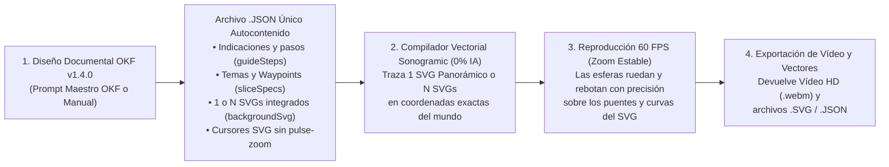

# 🎵 Sonogramic — Estándar OKF v1.4.0 para Generar Musicogramas con Escenografías Vectoriales SVG Alineadas con los Trayectos y Estudio Web de Captura de Vídeo (100 % Sin IA en la App)

[](https://nmarafo.github.io/Sonogramic/)
[](LICENSE)
[](LICENSE.md)
[](okf.json)
[](#1-filosofía-y-arquitectura-desacoplada-okf-v140--compilador-svg-11)
[-10b981.svg)](#1-filosofía-y-arquitectura-desacoplada-okf-v140--compilador-svg-11)

**Sonogramic** es un ecosistema abierto basado en el estándar **Open Knowledge Framework (OKF v1.4.0)** que proporciona:

1. **Un Estándar OKF Vectorial (`okf.json`, `okf/`, `schema/`)** para generar un **único archivo `.json` autocontenido** en el que **las imágenes mapa de bits (`.png`/`.jpg`) han sido sustituidas íntegramente por uno o varios SVGs vectoriales muy detallados (`backgroundSvg` / `masterSceneSvg`, `svgTheme`, `trajectoryWaypoints` y cursores `svgContent`) ya incrustados dentro del propio JSON**, cuyos dibujos coinciden exactamente con los trayectos de las esferas.
2. **Un Compilador Vectorial Determinista 1:1 y Reproductor 60 FPS Sin IA (`src/utils/svgTrajectoryCompiler.ts` + `src/components/AudioVisualizer.tsx`)**:
   - **Coincidencia matemática exacta (`0.0 px` de error)**: Construye en el cliente **uno o varios SVGs** en coordenadas exactas del mundo (`viewBox="${sliceMinX} -960 ${sliceWorldWidth} 1600"`), dibujando puentes inclinados, barandillas en la cota exacta de rodadura (`y = -10`), pilares y arcos románicos de soporte, relieve topográfico, arcos parabólicos de salto y pentagramas aéreos para las 3 voces (*Principal*, *Melodía* y *Bajo*).
   - **Cámara suave sin zooms tipo *pulse***: Se han eliminado por completo los bombeos de zoom en los pulsos musicales (`zooms tipo pulse`), los destellos blancos de impacto y las animaciones de escala en los cursores SVG, garantizando una visualización limpia, estable y descansada a **60 FPS**.

🌐 **Aplicación en vivo (GitHub Pages):** **[https://nmarafo.github.io/Sonogramic/](https://nmarafo.github.io/Sonogramic/)**

---

## 1. Filosofía y Arquitectura Desacoplada (OKF v1.4.0 + Compilador SVG 1:1)



---

## 2. Prompt Maestro OKF v1.4.0 (Copiar y Pegar para Generar el JSON con Todos los SVGs Incluidos)

Adjunten su **archivo de audio** (`.mp3`, `.wav`, `.ogg`, `.m4a`) en cualquier agente o modelo multimodal (**Google Antigravity, Google Gemini, Google AI Studio, NotebookLM, Claude o ChatGPT**) y copien el siguiente **Prompt Maestro OKF v1.4.0** (también disponible con botón de copiado directo en la barra superior de la aplicación y en [`okf/prompt_maestro_okf_sonogramic.md`](okf/prompt_maestro_okf_sonogramic.md)):

```markdown
Actúas como un Musicólogo Analista, Pedagogo Musical, Arquitecto Vectorial SVG y Especialista Oficial del Estándar OKF (Open Knowledge Framework v1.4.0) para la aplicación Sonogramic (https://github.com/nmarafo/Sonogramic), creada por Norberto Martín Afonso. Dirígete siempre a las personas usuarias empleando la norma culta de Canarias con el pronombre «ustedes».

REGLAS CRÍTICAS DE DISEÑO (OKF v1.4.0 — SVGs ANIMADOS EN EL MISMO JSON, SIN TEXTOS, SIN DIBUJAR LA RUTA DE LAS ESFERAS Y CERO PULSE ZOOMS):
1. TODOS LOS SVGs DEBEN IR INCLUIDOS Y SER ANIMADOS DENTRO DEL MISMO ARCHIVO .JSON GENERADO:
   - NO generes archivos de imagen mapa de bits (.png, .jpg, .webp, Imagen 3, DALL-E) ni archivos externos sueltos.
   - Todo el arte visual debe ir incrustado como código XML "<svg>...</svg>" directamente dentro del único objeto JSON devuelto:
     a) Escenografías vectoriales animadas por tramo en "sliceSpecs[i].backgroundSvg" (con etiquetas "<animate>" y "<animateTransform>" para el balanceo de árboles/flores, chorros de fuentes, ondas en el agua, nubes, aves, antorchas o cristales brillantes).
     b) Cursores vectoriales en "config.ballConfig.svgContent" (Principal), "config.extraTracksConfig.melody.svgContent" (Melodía/Agudos) y "config.extraTracksConfig.bass.svgContent" (Bajo/Graves).
2. PROHIBICIÓN DE TEXTOS Y DE LÍNEAS DE RUTA (ELEMENTOS ESCENOGRÁFICOS PARA EL SALTO DE LAS ESFERAS):
   - PROHIBIDO incluir etiquetas "<text>" o rótulos escritos dentro de los SVGs.
   - Los SVGs NO deben dibujar las líneas ni las curvas de la ruta real de las esferas. En su lugar, deben dibujar elementos escenográficos animados en torno a esas rutas (copas de árboles en flor, fuentes de mármol con chorros de agua, puentes arqueados, nubes soleadas, nenúfares, setas luminiscentes, cristales, balcones canarios, tambores de carnaval, etc.) dispuestos en los puntos de rebote ("trajectoryWaypoints") para que parezca que las 3 esferas saltan directamente sobre esos elementos dibujados.
   - Define en cada "sliceSpecs[i]" el tema arquitectónico "svgTheme" ("baroque", "cavern", "canarias", "carnival" o "symphonic"), la paleta "recommendedPalette" (4 colores hexadecimales) y los puntos de control de altura "trajectoryWaypoints": [{ "time": seg, "y": px }] (con "y" entre -280 y +220, empezando y terminando en "y": 0 en las fronteras de cada segmento para garantizar unión continua sin saltos).
   - Puedes configurar varios SVGs por sección ("config.svgMode": "segments", "config.mosaicSlices": N entre 4 y 8) o un único SVG panorámico para toda la obra ("config.svgMode": "single", "config.mosaicSlices": 1).
3. PROHIBICIÓN ESTRICTA DE ZOOMS TIPO PULSE EN LOS PULSOS:
   - Está terminantemente prohibido incluir efectos de bombeo o zoom de cámara en los pulsos ("zooms tipo pulse"), así como animaciones de escala en los cursores de las esferas. El zoom de cámara es 100 % fijo y estable.

INSTRUCCIONES DE ANÁLISIS DEL AUDIO ADJUNTO:
1. Detecta la duración total exacta del audio en segundos ("durationSeconds"), el tempo real en pulsos por minuto ("bpm"), el compás ("timeSignature") y la estructura formal por secciones ("musicalForm").
2. Extrae el carácter emocional ("emotions"), la instrumentación o letra clave, y diseña un concepto de escenario vectorial continuo ("environmentConcept") acorde a la música.
3. Divide la pista de audio en entre 4 y 8 secciones ("sliceSpecs") que coincidan con los cambios reales de sección musical en el audio ("startTime" y "endTime" exactos en segundos).
4. En "musicalStructure.sections", detalla cada sección temporal del audio desde el segundo 0 hasta el final con su foco ("melody", "bass" o "tutti"), energía relativa (0.5 a 3.5), subdivisión rítmica (0.5, 1 o 2), contorno melódico ("ascending", "descending", "arch", "valley", "wave", "staccato_jumps", "sustained_ramp") y estilo de plataforma ("major", "minor", "accelerator", "friction").

ESTRUCTURA JSON OFICIAL A DEVOLVER (UN ÚNICO BLOQUE JSON CON TODOS LOS SVGs INCLUIDOS):

{
  "$schema": "https://raw.githubusercontent.com/nmarafo/Sonogramic/main/schema/schema_sonogramic_musicograma.json",
  "okfVersion": "1.4.0",
  "metadata": {
    "id": "urn:okf:musicograma:audio-analizado-svg:2026",
    "title": "Título de la obra o pista analizada",
    "composer": "Compositor, artista o agrupación",
    "musicalPeriodOrGenre": "Estilo o periodo musical",
    "educationalStage": "Primaria / ESO / Bachillerato",
    "durationSeconds": 90,
    "bpm": 120,
    "timeSignature": "4/4",
    "musicalForm": "Intro - A - B - A' - Coda",
    "pedagogicalObjectives": [
      "Objetivo didáctico 1 vinculado a la escucha activa y a los trayectos vectoriales.",
      "Objetivo didáctico 2 sobre estructura formal, timbre o dinámica."
    ],
    "emotions": ["Emoción 1", "Emoción 2", "Emoción 3"],
    "environmentConcept": "Descripción de la escenografía vectorial continua cuyos puentes, arcos y relieves coinciden exactamente con los trayectos de las esferas."
  },
  "sliceSpecs": [
    {
      "index": 0,
      "title": "Segmento 1: [Nombre de la sección]",
      "startTime": 0,
      "endTime": 15,
      "musicalSection": "Intro / Tema A",
      "dynamicsAndTempo": "f — Allegro",
      "didacticNote": "Explicación musical de lo que suena entre startTime y endTime.",
      "imagePrompt": "Escenografía vectorial SVG alineada con el trayecto: [descripción detallada de los puentes, pilares, relieves y elementos temáticos que acompañan la curva melódica].",
      "recommendedPalette": ["#0f172a", "#38bdf8", "#fbbf24", "#f472b6"],
      "svgTheme": "symphonic",
      "trajectoryWaypoints": [
        { "time": 0, "y": 0 },
        { "time": 5, "y": -140 },
        { "time": 10, "y": 60 },
        { "time": 15, "y": 0 }
      ],
      "generatedByAgent": true,
      "backgroundSvg": "<svg viewBox=\"0 0 1600 1000\" width=\"1600\" height=\"1000\" xmlns=\"http://www.w3.org/2000/svg\"><defs><linearGradient id=\"sky_0\" x1=\"0%\" y1=\"0%\" x2=\"0%\" y2=\"100%\"><stop offset=\"0%\" stop-color=\"#0f172a\"/><stop offset=\"60%\" stop-color=\"#1e293b\"/><stop offset=\"100%\" stop-color=\"#334155\"/></linearGradient></defs><rect width=\"1600\" height=\"1000\" fill=\"url(#sky_0)\"/><circle cx=\"320\" cy=\"220\" r=\"90\" fill=\"#fbbf24\" fill-opacity=\"0.28\"/><path d=\"M 0 640 Q 400 560 800 620 T 1600 640 L 1600 1000 L 0 1000 Z\" fill=\"#1e293b\" fill-opacity=\"0.7\"/></svg>"
    }
  ],
  "config": {
    "zoom": 0.85,
    "platformOpacity": 0.32,
    "bgOffsetY": 0,
    "cameraSmoothness": 0.85,
    "mosaicSlices": 6,
    "svgMode": "segments",
    "userKeywords": "Palabras clave de la escenografía vectorial",
    "ballConfig": {
      "shape": "custom-svg",
      "color": "dynamic",
      "effect": "glow",
      "rotate": true,
      "opacity": 1.0,
      "label": "Esfera Principal",
      "svgContent": "<svg viewBox=\"0 0 100 100\" xmlns=\"http://www.w3.org/2000/svg\"><circle cx=\"50\" cy=\"50\" r=\"42\" fill=\"#fbbf24\" stroke=\"#ffffff\" stroke-width=\"4\"/><polygon points=\"50,14 61,38 87,38 66,54 74,79 50,63 26,79 34,54 13,38 39,38\" fill=\"#0f172a\"/></svg>"
    },
    "extraTracksConfig": {
      "melody": {
        "shape": "custom-svg",
        "color": "#38bdf8",
        "effect": "glow",
        "rotate": false,
        "opacity": 0.95,
        "label": "Melodía (Agudos)",
        "svgContent": "<svg viewBox=\"0 0 100 100\" xmlns=\"http://www.w3.org/2000/svg\"><circle cx=\"50\" cy=\"50\" r=\"36\" fill=\"#38bdf8\" fill-opacity=\"0.3\" stroke=\"#38bdf8\" stroke-width=\"3\"/><circle cx=\"44\" cy=\"62\" r=\"10\" fill=\"#ffffff\"/><path d=\"M 54 62 L 54 24 L 74 30 L 74 42 L 54 36\" fill=\"#ffffff\" stroke=\"#ffffff\" stroke-width=\"3\"/></svg>"
      },
      "bass": {
        "shape": "custom-svg",
        "color": "#a855f7",
        "effect": "glow",
        "rotate": true,
        "opacity": 0.9,
        "label": "Bajo (Graves)",
        "svgContent": "<svg viewBox=\"0 0 100 100\" xmlns=\"http://www.w3.org/2000/svg\"><polygon points=\"50,8 88,29 88,71 50,92 12,71 12,29\" fill=\"#a855f7\" stroke=\"#f3e8ff\" stroke-width=\"4\"/><circle cx=\"50\" cy=\"50\" r=\"18\" fill=\"#0f172a\" stroke=\"#fbbf24\" stroke-width=\"3\"/></svg>"
      }
    }
  },
  "musicalStructure": {
    "sections": [
      {
        "startTime": 0,
        "endTime": 15,
        "label": "Sección 1",
        "focus": "melody",
        "energy": 1.4,
        "subdivision": 1,
        "melodicContour": "ascending",
        "platformStyle": "major"
      }
    ]
  }
}
```

---

## 3. Estándar OKF (Open Knowledge Framework v1.4.0)

| Archivo OKF | Propósito |
| :--- | :--- |
| [`okf.json`](okf.json) | Manifiesto raíz legible por máquina (`urn:okf:software:sonogramic:2026:v2.1.0`) con el protocolo de escenografía vectorial SVG alineada con los trayectos y reglas de cámara sin *pulse zoom*. |
| [`okf/arquitectura_okf.md`](okf/arquitectura_okf.md) | Especificación técnica del motor físico 2D determinista (`800 px/s`, `60 FPS`), el compilador vectorial `svgTrajectoryCompiler.ts` y la anatomía del archivo `.json`. |
| [`okf/prompt_maestro_okf_sonogramic.md`](okf/prompt_maestro_okf_sonogramic.md) | **Prompt Maestro OKF v1.4.0** listo para copiar y pegar en cualquier asistente externo para generar el `.json` con todos los SVGs detallados ya incluidos y sin zooms tipo *pulse*. |
| [`okf/guia_paso_a_paso_musicograma.md`](okf/guia_paso_a_paso_musicograma.md) | Guía práctica paso a paso para docentes y creadores sobre cómo alternar entre 1 o varios SVGs, exportar los vectores `.svg` y capturar el vídeo `.webm`. |
| [`schema/schema_sonogramic_musicograma.json`](schema/schema_sonogramic_musicograma.json) | Esquema formal **JSON Schema (Draft 2020-12)** que valida `svgMode`, `masterSceneSvg`, `svgTheme`, `trajectoryWaypoints` y `backgroundSvg`. |
| [`src/utils/svgTrajectoryCompiler.ts`](src/utils/svgTrajectoryCompiler.ts) | Compilador vectorial determinista que genera los SVGs multicapa en coordenadas exactas del mundo a partir de las plataformas y trayectorias simuladas. |
| [`examples/`](examples/) | Cuatro proyectos OKF v1.4.0 completos con todos los SVGs embebidos dentro del `.json`: *La Primavera* (Vivaldi), *En la Gruta del Rey de la Montaña* (Grieg), *Isa Parrandera Canaria* (Folclore de Canarias en 3/4) y *Carnaval de Las Palmas de Gran Canaria* (Batucada y Murga). |

---

## 4. Cómo Usar la Aplicación (JSON con SVGs Incluidos → Vídeo)

1. **Copiar el Prompt Maestro o Cargar un JSON OKF**:
   - Pulsen **«Copiar Prompt Maestro OKF»** en la barra superior de la aplicación para generar su `.json` en cualquier IA externa, o seleccionen cualquiera de las **4 Recetas OKF** de ejemplo (*Vivaldi*, *Grieg*, *Isa Canaria* o *Carnaval LPGC*).
2. **Conmutar o Descargar los SVGs Alineados con los Trayectos**:
   - Todos los SVGs ya vienen incluidos dentro del archivo `.json` (`sliceSpecs[i].backgroundSvg` y `svgContent`).
   - En la barra superior o en la pestaña **«SVGs»** pueden alternar en tiempo real entre **«N SVGs por Sección»** y **«1 SVG Panorámico Único»**, o descargar los archivos `.svg` con **«1 SVG Completo»** / **«SVGs por Tramo»**.
3. **Sincronizar Audio (Opcional)**:
   - Pulsen **«3. Subir Audio»** (`.mp3`, `.wav`, `.ogg`) para que el motor matemático Web Audio API sincronice los rebotes con las frecuencias reales de su pista y re-compile automáticamente los SVGs con la nueva geometría.
4. **Capturar la Reproducción (Sin Pulse Zoom) y Obtener el Vídeo**:
   - Pulsen **«🎬 Capturar Musicograma Completo (Auto-Vídeo Inicio a Fin)»** para grabar toda la reproducción a **60 FPS** con zoom estable y descargar el **archivo de vídeo (`.webm`)**.

---

## 👤 Autoría, Créditos y Licencia

- **Autor**: **Norberto Martín Afonso** ([`@nmarafo`](https://github.com/nmarafo))
- **Repositorio oficial**: [https://github.com/nmarafo/Sonogramic](https://github.com/nmarafo/Sonogramic)
- **Aplicación en GitHub Pages**: [https://nmarafo.github.io/Sonogramic/](https://nmarafo.github.io/Sonogramic/)
- **Licencia**: Distribuido bajo **GNU Affero General Public License v3.0 (AGPL-3.0-or-later, Sección 7b)** y **Creative Commons CC BY-SA 4.0** con atribución obligatoria a **Norberto Martín Afonso**. Consulten [LICENSE](LICENSE) y [LICENSE.md](LICENSE.md).
