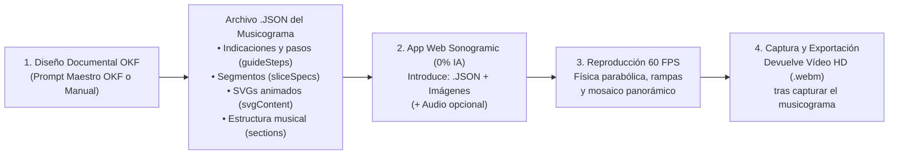

# 🎵 Sonogramic — Estándar OKF para Generar Musicogramas en JSON y Estudio Web de Reproducción y Captura de Vídeo (100 % Sin IA en la App)

[](https://nmarafo.github.io/Sonogramic/)
[](LICENSE)
[](LICENSE.md)
[](okf.json)
[-10b981.svg)](#1-filosofía-y-arquitectura-desacoplada-okf--app-sin-ia)

**Sonogramic** es un ecosistema abierto basado en el estándar **Open Knowledge Framework (OKF v1.3.0)** que proporciona:

1. **Un Estándar OKF (`okf.json`, `okf/`, `schema/`)** para generar un **archivo `.json`** con todas las **indicaciones, los pasos guiados (`guideSteps`), las especificaciones de cada segmento (`sliceSpecs`), los iconos vectoriales SVG animados (`svgContent`) y la estructura musical (`musicalStructure`)** necesarios para construir un musicograma fluido.
2. **Una Aplicación Web 100 % Sin IA (`index.html` / `src/`)**: Nuestra aplicación **no utiliza Inteligencia Artificial ni depende de claves API ni servidores externos**. Únicamente toma **las imágenes que ustedes introduzcan más el archivo `.json`** (y opcionalmente el archivo de audio), muestra el musicograma interactivo a **60 FPS** y **devuelve un archivo de vídeo en alta definición (`.webm`)** después de haber capturado la reproducción del musicograma.

🌐 **Aplicación en vivo (GitHub Pages):** **[https://nmarafo.github.io/Sonogramic/](https://nmarafo.github.io/Sonogramic/)**

---

## 1. Filosofía y Arquitectura Desacoplada (OKF + App Sin IA)



### ¿Por qué separar el OKF de la Aplicación?
- **Privacidad, velocidad y ejecución 100 % local en navegador**: La aplicación web funciona íntegramente en el cliente mediante **HTML5 Canvas 2D**, **Web Audio API** y **MediaRecorder API**, sin llamadas a modelos de IA ni costes de API.
- **Control pedagógico y visual total**: Ustedes deciden qué imágenes colocar en cada segmento del musicograma (ilustraciones propias, dibujos del alumnado o láminas preparadas siguiendo las plantillas guía de plataformas descargables desde la propia aplicación).
- **Indicaciones y pasos integrados en el JSON**: Al cargar cualquier `.json` compatible con el estándar OKF de Sonogramic, la aplicación despliega automáticamente la **ficha musicológica**, la **lista interactiva de pasos (`guideSteps`)** con botones de acción rápida y las **tarjetas de cada segmento (`sliceSpecs`)**.

---

## 2. Estándar OKF (Open Knowledge Framework) para Generar el JSON

| Archivo OKF | Propósito |
| :--- | :--- |
| [`okf.json`](okf.json) | Manifiesto raíz legible por máquina (`urn:okf:software:sonogramic:2026:v2.0.0`) con metadatos, flujo de trabajo y catálogo de funciones programáticas (`window.applyOkfMusicogramaConfig`). |
| [`okf/arquitectura_okf.md`](okf/arquitectura_okf.md) | Especificación técnica del motor físico 2D determinista (`800 px/s`, `60 FPS`), plantillas guía de plataformas y anatomía del archivo `.json`. |
| [`okf/prompt_maestro_okf_sonogramic.md`](okf/prompt_maestro_okf_sonogramic.md) | **Prompt Maestro OKF** listo para copiar y pegar en cualquier asistente externo (NotebookLM, Gemini, Claude, ChatGPT, Ollama) para generar el `.json` con las indicaciones y pasos de cualquier obra musical. |
| [`okf/guia_paso_a_paso_musicograma.md`](okf/guia_paso_a_paso_musicograma.md) | Guía práctica paso a paso para docentes y creadores sobre cómo combinar el JSON + imágenes + audio y capturar el vídeo. |
| [`schema/schema_sonogramic_musicograma.json`](schema/schema_sonogramic_musicograma.json) | Esquema formal **JSON Schema (Draft 2020-12)** que valida los archivos `.json` de musicograma y los proyectos exportados. |
| [`examples/`](examples/) | Tres proyectos OKF completos listos para usar: *La Primavera* (Vivaldi), *En la Gruta del Rey de la Montaña* (Grieg) e *Isa Parrandera Canaria* (Folclore de Canarias en 3/4). |

---

## 3. Prompt Maestro OKF (Adjuntar Audio → Obtener el JSON + Imágenes de Fondo)

Adjunten su **archivo de audio** (`.mp3`, `.wav`, `.ogg`, `.m4a`) en cualquier agente o modelo multimodal (**Google Antigravity, Google Gemini, Google AI Studio, NotebookLM o ChatGPT**) y peguen el siguiente bloque (también disponible completo en [`okf/prompt_maestro_okf_sonogramic.md`](okf/prompt_maestro_okf_sonogramic.md)):

```markdown
Actúas como un Musicólogo Analista, Pedagogo Musical, Ilustrador Escénico y Arquitecto Oficial del Estándar OKF (Open Knowledge Framework v1.3.0) para la aplicación Sonogramic (https://github.com/nmarafo/Sonogramic), creada por Norberto Martín Afonso. Dirígete siempre a las personas usuarias empleando la norma culta de Canarias con el pronombre «ustedes».

TAREA PRINCIPAL:
1. Escucha y analiza de principio a fin el ARCHIVO DE AUDIO adjunto.
2. Genera el objeto JSON válido que siga el esquema oficial de Sonogramic para construir su musicograma interactivo.
3. PROTOCOLO OKF DE GENERACIÓN AUTOMÁTICA DE BACKGROUNDS (SI TIENES CAPACIDAD DE GENERAR IMÁGENES):
   - MODO A (Agente con herramienta generadora de imágenes rasterizadas: Imagen 3, DALL-E, subagente image-generator o acceso a archivos):
     Genera automáticamente las N imágenes panorámicas de fondo (una por cada segmento de "sliceSpecs") ejecutando el "imagePrompt" y la paleta "recommendedPalette" de cada sección, manteniendo continuidad horizontal de izquierda a derecha. Si puedes referenciarlas por URL, ruta local o Data URI ("data:image/...;base64,..."), asígnalas en "sliceSpecs[i].imageUrl" con "generatedByAgent": true. Si estás en un chat conversacional, genera y entrega las N imágenes numeradas ("01_segmento_1.png" ... "0N_segmento_N.png") junto con el JSON.
   - MODO B (Fondo Panorámico Autocontenido en el JSON mediante "backgroundSvg"):
     En todos los casos, genera e incrusta directamente dentro de cada "sliceSpecs[i].backgroundSvg" un escenario panorámico ilustrado multicapa "<svg viewBox='0 0 1024 1024' width='1024' height='1024' xmlns='http://www.w3.org/2000/svg'>...</svg>" (con cielo en <linearGradient>, iluminación, motivos temáticos y planos de paisaje continuos cuyo horizonte en x=1024 del segmento i coincida con x=0 del segmento i+1) y marca "generatedByAgent": true. Así, al importar el JSON en Sonogramic, el musicograma tendrá todos sus backgrounds listos automáticamente sin usar IA en la aplicación web.

INSTRUCCIONES DE ANÁLISIS DEL AUDIO ADJUNTO:
1. Detecta la duración total exacta del audio en segundos ("durationSeconds"), el tempo real en pulsos por minuto ("bpm"), el compás ("timeSignature") y la estructura formal por secciones ("musicalForm").
2. Extrae el carácter emocional ("emotions"), la instrumentación o letra clave, y diseña un concepto de escenario visual continuo ("environmentConcept") acorde a la música.
3. Divide la pista de audio en entre 4 y 8 segmentos horizontales ("sliceSpecs") que coincidan con los cambios reales de sección musical en el audio (indicando "startTime" y "endTime" exactos en segundos).
4. Para cada segmento en "sliceSpecs", incluye:
   - "didacticNote": qué ocurre musicalmente en ese tramo del audio (entradas instrumentales, cambios de dinámica f/p, ritmo, melodía).
   - "imagePrompt": instrucciones visuales detalladas para crear la ilustración de fondo de ese segmento respetando las plataformas por donde rueda la esfera y manteniendo bordes izquierdo y derecho continuos.
   - "recommendedPalette": array de 4 colores hexadecimales acordes a la atmósfera de la sección.
   - "generatedByAgent": true.
   - "imageUrl": (si generaste imagen rasterizada con herramienta externa y dispones de su ruta/URL/Data URI).
   - "backgroundSvg": código XML "<svg viewBox='0 0 1024 1024' width='1024' height='1024' xmlns='http://www.w3.org/2000/svg'>...</svg>" con la ilustración panorámica multicapa de fondo para ese segmento.
5. En "config", incluye dentro de "ballConfig" (esfera principal), "extraTracksConfig.melody" (registro agudo) y "extraTracksConfig.bass" (registro grave) la propiedad "shape": "custom-svg" con un código XML "<svg viewBox=\"0 0 100 100\" xmlns=\"http://www.w3.org/2000/svg\">...</svg>" completo y animado (<animate>, <animateTransform repeatCount="indefinite"> o @keyframes CSS) que represente visualmente la temática del audio.
6. En "musicalStructure.sections", detalla cada sección temporal del audio desde el segundo 0 hasta el final con su foco ("melody", "bass" o "tutti"), energía relativa (0.5 a 3.5), subdivisión rítmica (0.5, 1 o 2), contorno melódico ("ascending", "descending", "arch", "valley", "wave", "staccato_jumps", "sustained_ramp") y estilo de plataforma ("major", "minor", "accelerator", "friction").
```

---

## 4. Cómo Usar la Aplicación (JSON + Imágenes → Vídeo)

1. **Cargar el JSON OKF**:
   - Pulsen **«1. Cargar JSON OKF»**, **«Pegar JSON»** o seleccionen una de las **Recetas JSON OKF de Ejemplo** en la barra superior.
2. **Descargar Plantillas Guía e Introducir las Imágenes**:
   - *(Opcional)* Pulsen **«Plantillas Guía»** para descargar los lienzos de referencia (`1024 × 1024 px`) con los rectángulos blancos exactos de las plataformas de cada segmento.
   - Pulsen **«2. Subir Imágenes»** para cargar todas las imágenes de los segmentos en lote (o súbanlas una a una desde la pestaña **«Imágenes»**).
   - También pueden personalizar las tres esferas (*Principal*, *Melodía* y *Bajo*) con los iconos SVG incluidos en el JSON o subiendo cualquier archivo `.svg` / `.png`.
3. **Sincronizar Audio (Opcional)**:
   - Pulsen **«3. Subir Audio»** (`.mp3`, `.wav`, `.ogg`) para que el motor matemático Web Audio API sincronice los rebotes con las frecuencias graves (`< 150 Hz`) y agudas (`> 800 Hz`) de su pista, o reproduzcan directamente con el sintetizador rítmico integrado del JSON.
4. **Capturar la Reproducción y Obtener el Vídeo**:
   - Pulsen **«🎬 Capturar Musicograma Completo (Auto-Vídeo Inicio a Fin)»**.
   - La aplicación rebobinará al instante `00:00`, capturará toda la reproducción del musicograma a **60 FPS** junto con el audio y les devolverá automáticamente el **archivo de vídeo (`.webm`)**.

---

## 5. Estructura del Repositorio

```text
Sonogramic/
├── index.html                                  # Punto de entrada de la aplicación web (100 % Sin IA)
├── okf.json                                    # Manifiesto raíz Open Knowledge Framework (OKF v1.3.0)
├── okf/
│   ├── arquitectura_okf.md                     # Manual técnico y operativo del estándar OKF y motor físico
│   ├── prompt_maestro_okf_sonogramic.md        # System Prompt oficial para generar el JSON del musicograma
│   └── guia_paso_a_paso_musicograma.md         # Guía práctica de creación y captura de vídeo
├── schema/
│   └── schema_sonogramic_musicograma.json      # JSON Schema (Draft 2020-12) para validar recetas y proyectos
├── examples/
│   ├── vivaldi_primavera_okf.json              # Receta OKF: La Primavera (Allegro) — Antonio Vivaldi
│   ├── grieg_rey_montana_okf.json              # Receta OKF: En la Gruta del Rey de la Montaña — Edvard Grieg
│   └── isa_canaria_okf.json                    # Receta OKF: Isa Parrandera Canaria (Compás 3/4)
├── src/
│   ├── App.tsx                                 # Interfaz principal, visor de pasos OKF, gestor de imágenes y exportación
│   ├── main.tsx                                # Inicialización React
│   ├── index.css                               # Estilos Tailwind CSS
│   ├── types/
│   │   └── okf.ts                              # Definiciones TypeScript del estándar OKF de Sonogramic
│   ├── data/
│   │   └── exampleProjects.ts                  # Recetas OKF precargadas para uso inmediato offline
│   └── components/
│       └── AudioVisualizer.tsx                 # Motor físico 60 FPS, Web Audio API DSP y captura de vídeo MediaRecorder
├── LICENSE                                     # Licencia GNU AGPL-3.0 con cláusula de atribución (Sección 7b)
├── LICENSE.md                                  # Resumen de licencia dual GNU AGPL-3.0 + Creative Commons CC BY-SA 4.0
├── package.json                                # Dependencias limpias de cliente (Vite + React + Tailwind, sin IA)
├── vite.config.ts                              # Configuración de compilación estática para GitHub Pages
└── .github/
    └── workflows/
        └── deploy-pages.yml                    # Despliegue automatizado en GitHub Pages
```

---

## 6. Ejecución en Local

1. Instalar dependencias:
   ```bash
   npm install
   ```
2. Iniciar el servidor de desarrollo local (sin necesidad de variables de entorno ni claves API):
   ```bash
   npm run dev
   ```
3. Generar la compilación estática de producción (`dist/`):
   ```bash
   npm run build
   ```

---

## 👤 Autoría, Créditos y Redes Sociales

- **Autor**: **Norberto Martín Afonso**
- **Repositorio oficial**: [https://github.com/nmarafo/Sonogramic](https://github.com/nmarafo/Sonogramic)
- **Aplicación en GitHub Pages**: [https://nmarafo.github.io/Sonogramic/](https://nmarafo.github.io/Sonogramic/)
- **Redes sociales**:
  - 🐦 **X (Twitter)**: [@NorbertoMartnAf](https://x.com/NorbertoMartnAf)
  - 💼 **GitHub**: [@nmarafo](https://github.com/nmarafo)
  - 🤗 **Hugging Face**: [@nmarafo](https://huggingface.co/nmarafo)
  - 📸 **Instagram**: [@nmar_afo](https://instagram.com/nmar_afo)

---

## 📄 Licencia y Cláusula de Atribución Obligatoria

- **Software y código fuente**: Distribuido bajo los términos de la licencia **GNU Affero General Public License v3.0 (AGPL-3.0-or-later)** con preservación obligatoria de atribución de autoría conforme a la **Sección 7(b)**.
- **Especificación OKF, esquemas JSON, guías y prompts**: Distribuidos bajo licencia **Creative Commons Atribución-CompartirIgual 4.0 Internacional (CC BY-SA 4.0)**.

### Cláusula de Atribución Obligatoria (Sección 7b AGPL-3.0 y CC BY-SA 4.0)

Conforme a la Sección 7(b) de la licencia GNU Affero General Public License v3.0 y a los términos de atribución de CC BY-SA 4.0, cualquier redistribución, modificación, obra derivada, adaptación o integración de este software o de su especificación OKF en otros sistemas, cuadernos RAG o agentes de IA debe preservar de forma visible el aviso de copyright original y la atribución expresa a su autor en el código fuente, en la documentación y en la interfaz de usuario:

> *Basado en [Sonogramic](https://github.com/nmarafo/Sonogramic), creado por **Norberto Martín Afonso**, distribuido bajo licencia GNU Affero General Public License v3.0 (AGPL-3.0-or-later) y Creative Commons Atribución-CompartirIgual 4.0 Internacional (CC BY-SA 4.0).*

Consulten los archivos [LICENSE](LICENSE) y [LICENSE.md](LICENSE.md) para conocer el texto legal completo.
