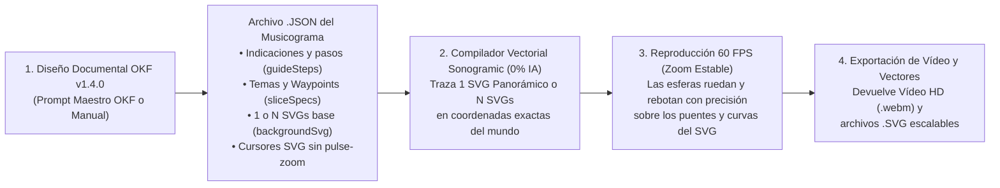

# 🎵 Sonogramic — Estándar OKF v1.4.0 para Generar Musicogramas con Escenografías Vectoriales SVG Alineadas con los Trayectos y Estudio Web de Captura de Vídeo (100 % Sin IA en la App)

[](https://nmarafo.github.io/Sonogramic/)
[](LICENSE)
[](LICENSE.md)
[](okf.json)
[](#1-filosofía-y-arquitectura-desacoplada-okf-v140--compilador-svg-11)
[-10b981.svg)](#1-filosofía-y-arquitectura-desacoplada-okf-v140--compilador-svg-11)

**Sonogramic** es un ecosistema abierto basado en el estándar **Open Knowledge Framework (OKF v1.4.0)** que proporciona:

1. **Un Estándar OKF Vectorial (`okf.json`, `okf/`, `schema/`)** para generar un **archivo `.json`** en el que **las imágenes mapa de bits (`.png`/`.jpg`) han sido sustituidas íntegramente por uno o varios SVGs vectoriales muy detallados (`backgroundSvg` / `masterSceneSvg`, `svgTheme` y `trajectoryWaypoints`)** cuyos dibujos coinciden exactamente con los trayectos de las esferas.
2. **Un Compilador Vectorial Determinista 1:1 y Reproductor 60 FPS Sin IA (`src/utils/svgTrajectoryCompiler.ts` + `src/components/AudioVisualizer.tsx`)**:
   - **Coincidencia matemática exacta (`0.0 px` de error)**: Construye en el cliente **uno o varios SVGs** en coordenadas exactas del mundo (`viewBox="${sliceMinX} -960 ${sliceWorldWidth} 1600"`), dibujando puentes inclinados, barandillas en la cota exacta de rodadura (`y = -10`), pilares y arcos románicos de soporte, relieve topográfico, arcos parabólicos de salto y pentagramas aéreos para las 3 voces (*Principal*, *Melodía* y *Bajo*).
   - **Cámara suave sin zooms tipo *pulse***: Se han eliminado por completo los bombeos de zoom en los pulsos musicales (`zooms tipo pulse`), los destellos blancos de impacto y las animaciones de escala en los cursores SVG, garantizando una visualización limpia, estable y descansada a **60 FPS**.

🌐 **Aplicación en vivo (GitHub Pages):** **[https://nmarafo.github.io/Sonogramic/](https://nmarafo.github.io/Sonogramic/)**

---

## 1. Filosofía y Arquitectura Desacoplada (OKF v1.4.0 + Compilador SVG 1:1)



### Novedades Clave de la Arquitectura OKF v1.4.0
- **Sustitución total de mapas de bits por SVGs alineados con los trayectos**: Ya no se emplean archivos `.png`/`.jpg` estáticos cuyos dibujos quedaban desalineados respecto a las plataformas. Ahora cada tramo (o el musicograma entero en modo de **1 SVG Panorámico Único**) es un documento vectorial `<svg>` cuyas estructuras arquitectónicas se ensamblan exactamente sobre las coordenadas `{ x, y, width, height, angle }` de cada plataforma y sobre las curvas `{ time, x, y }` de cada esfera.
- **Modo Dual de Escenografía SVG (`svgMode`)**:
  - **Varios SVGs por Sección (`N SVGs`)**: Genera un SVG detallado e independiente para cada sección formal de la obra (`Intro`, `Tema A`, `Tema B`, `Coda`), con transiciones suaves que convergen en `y = 0` en los bordes de sección.
  - **Un Único SVG Panorámico (`1 SVG`)**: Compila un único documento SVG continuo (`viewBox="0 -960 ${totalWorldWidth} 1600"`) para toda la pieza musical.
- **Eliminación de los zooms tipo *pulse* en los pulsos**:
  - La cámara mantiene un factor de zoom 100 % constante (`config.zoom`), sin sacudidas ni cambios de escala en los pulsos fuertes, aceleradores o de fricción.
  - Los iconos SVG de las esferas (`svgContent`) se sanitizan automáticamente para impedir animaciones `<animate attributeName="r">` o `<animateTransform type="scale">`.

---

## 2. Estándar OKF (Open Knowledge Framework v1.4.0)

| Archivo OKF | Propósito |
| :--- | :--- |
| [`okf.json`](okf.json) | Manifiesto raíz legible por máquina (`urn:okf:software:sonogramic:2026:v2.1.0`) con el protocolo de escenografía vectorial SVG alineada con los trayectos y reglas de cámara sin *pulse zoom*. |
| [`okf/arquitectura_okf.md`](okf/arquitectura_okf.md) | Especificación técnica del motor físico 2D determinista (`800 px/s`, `60 FPS`), el compilador vectorial `svgTrajectoryCompiler.ts` y la anatomía del archivo `.json`. |
| [`okf/prompt_maestro_okf_sonogramic.md`](okf/prompt_maestro_okf_sonogramic.md) | **Prompt Maestro OKF v1.4.0** listo para copiar y pegar en cualquier asistente externo para generar el `.json` con uno o varios SVGs detallados alineados con los trayectos y sin zooms tipo *pulse*. |
| [`okf/guia_paso_a_paso_musicograma.md`](okf/guia_paso_a_paso_musicograma.md) | Guía práctica paso a paso para docentes y creadores sobre cómo alternar entre 1 o varios SVGs, exportar los vectores `.svg` y capturar el vídeo `.webm`. |
| [`schema/schema_sonogramic_musicograma.json`](schema/schema_sonogramic_musicograma.json) | Esquema formal **JSON Schema (Draft 2020-12)** que valida `svgMode`, `masterSceneSvg`, `svgTheme`, `trajectoryWaypoints` y `backgroundSvg`. |
| [`src/utils/svgTrajectoryCompiler.ts`](src/utils/svgTrajectoryCompiler.ts) | Compilador vectorial determinista que genera los SVGs multicapa en coordenadas exactas del mundo a partir de las plataformas y trayectorias simuladas. |
| [`examples/`](examples/) | Cuatro proyectos OKF v1.4.0 completos listos para usar: *La Primavera* (Vivaldi), *En la Gruta del Rey de la Montaña* (Grieg), *Isa Parrandera Canaria* (Folclore de Canarias en 3/4) y *Carnaval de Las Palmas de Gran Canaria* (Batucada y Murga). |

---

## 3. Cómo Usar la Aplicación (JSON Vectorial → SVGs Alineados → Vídeo)

1. **Cargar un Proyecto JSON OKF o Ejemplo Integrado**:
   - Seleccionen cualquiera de las **4 Recetas OKF** de la barra superior (*Vivaldi*, *Grieg*, *Isa Canaria* o *Carnaval LPGC*) o carguen su propio archivo con **«1. Cargar JSON OKF»** / **«Pegar JSON»**.
2. **Conmutar o Descargar los SVGs Alineados con los Trayectos**:
   - En la barra superior o en la pestaña **«SVGs»** pueden alternar en tiempo real entre **«N SVGs por Sección»** y **«1 SVG Panorámico Único»**, o pulsar **«Re-compilar SVGs»**.
   - Pulsen **«1 SVG Completo»** o **«SVGs por Tramo»** para descargar los archivos `.svg` vectoriales con todos los puentes, pilares, relieves y curvas de trayectoria exactamente trazados.
   - Si editan un archivo `.svg` en Inkscape o Illustrator, pueden volver a cargarlo con **«2. Subir SVGs»**.
3. **Sincronizar Audio (Opcional)**:
   - Pulsen **«3. Subir Audio»** (`.mp3`, `.wav`, `.ogg`) para que el motor matemático Web Audio API sincronice los rebotes con las frecuencias reales de su pista y re-compile automáticamente los SVGs con la nueva geometría.
4. **Capturar la Reproducción (Sin Pulse Zoom) y Obtener el Vídeo**:
   - Pulsen **«🎬 Capturar Musicograma Completo (Auto-Vídeo Inicio a Fin)»** para grabar toda la reproducción a **60 FPS** con zoom estable y descargar el **archivo de vídeo (`.webm`)**.

---

## 4. Estructura del Repositorio

```text
Sonogramic/
├── index.html                                  # Punto de entrada de la aplicación web (100 % Sin IA)
├── okf.json                                    # Manifiesto raíz Open Knowledge Framework (OKF v1.4.0)
├── okf/
│   ├── arquitectura_okf.md                     # Manual técnico del compilador SVG 1:1 y motor físico sin pulse-zoom
│   ├── prompt_maestro_okf_sonogramic.md        # System Prompt oficial OKF v1.4.0 (100 % SVG, 0 % mapas de bits)
│   └── guia_paso_a_paso_musicograma.md         # Guía práctica de creación vectorial y captura de vídeo
├── schema/
│   └── schema_sonogramic_musicograma.json      # JSON Schema (Draft 2020-12) para validar recetas OKF v1.4.0
├── examples/
│   ├── vivaldi_primavera_okf.json              # Receta OKF: La Primavera (Allegro) — Antonio Vivaldi (Baroque SVG)
│   ├── grieg_rey_montana_okf.json              # Receta OKF: En la Gruta del Rey de la Montaña — Edvard Grieg (Cavern SVG)
│   ├── isa_canaria_okf.json                    # Receta OKF: Isa Parrandera Canaria (Canarias SVG)
│   └── musicograma_carnaval_las_palmas_okf.json# Receta OKF: Carnaval de Las Palmas de GC (Carnival SVG)
├── src/
│   ├── App.tsx                                 # Interfaz principal, gestor de SVGs por tramo o único y exportación
│   ├── main.tsx                                # Inicialización React
│   ├── index.css                               # Estilos Tailwind CSS
│   ├── types/
│   │   └── okf.ts                              # Definiciones TypeScript del estándar OKF v1.4.0
│   ├── utils/
│   │   └── svgTrajectoryCompiler.ts            # Compilador de SVGs detallados en coordenadas exactas de los trayectos
│   ├── data/
│   │   └── exampleProjects.ts                  # 4 Recetas OKF vectoriales precargadas
│   └── components/
│       └── AudioVisualizer.tsx                 # Motor físico 60 FPS (sin pulse-zoom), renderizador SVG y MediaRecorder
├── LICENSE                                     # Licencia GNU AGPL-3.0 con cláusula de atribución (Sección 7b)
├── LICENSE.md                                  # Resumen de licencia dual GNU AGPL-3.0 + Creative Commons CC BY-SA 4.0
├── package.json                                # Dependencias limpias de cliente (Vite + React + Tailwind, sin IA)
└── vite.config.ts                              # Configuración de compilación estática para GitHub Pages
```

---

## 5. Ejecución en Local

1. Instalar dependencias:
   ```bash
   npm install
   ```
2. Iniciar el servidor de desarrollo local:
   ```bash
   npm run dev
   ```
3. Generar la compilación estática de producción (`dist/`):
   ```bash
   npm run build
   ```

---

## 👤 Autoría, Créditos y Redes Sociales

- **Autor**: **Norberto Martín Afonso**
- **Repositorio oficial**: [https://github.com/nmarafo/Sonogramic](https://github.com/nmarafo/Sonogramic)
- **Aplicación en GitHub Pages**: [https://nmarafo.github.io/Sonogramic/](https://nmarafo.github.io/Sonogramic/)
- **Redes sociales**:
  - 🐦 **X (Twitter)**: [@NorbertoMartnAf](https://x.com/NorbertoMartnAf)
  - 💼 **GitHub**: [@nmarafo](https://github.com/nmarafo)
  - 🤗 **Hugging Face**: [@nmarafo](https://huggingface.co/nmarafo)
  - 📸 **Instagram**: [@nmar_afo](https://instagram.com/nmar_afo)

---

## 📄 Licencia y Cláusula de Atribución Obligatoria

- **Software y código fuente**: Distribuido bajo los términos de la licencia **GNU Affero General Public License v3.0 (AGPL-3.0-or-later)** con preservación obligatoria de atribución de autoría conforme a la **Sección 7(b)**.
- **Especificación OKF, esquemas JSON, guías y prompts**: Distribuidos bajo licencia **Creative Commons Atribución-CompartirIgual 4.0 Internacional (CC BY-SA 4.0)**.

### Cláusula de Atribución Obligatoria (Sección 7b AGPL-3.0 y CC BY-SA 4.0)

Conforme a la Sección 7(b) de la licencia GNU Affero General Public License v3.0 y a los términos de atribución de CC BY-SA 4.0, cualquier redistribución, modificación, obra derivada, adaptación o integración de este software o de su especificación OKF en otros sistemas, cuadernos RAG o agentes de IA debe preservar de forma visible el aviso de copyright original y la atribución expresa a su autor en el código fuente, en la documentación y en la interfaz de usuario:

> *Basado en [Sonogramic](https://github.com/nmarafo/Sonogramic), creado por **Norberto Martín Afonso**, distribuido bajo licencia GNU Affero General Public License v3.0 (AGPL-3.0-or-later) y Creative Commons Atribución-CompartirIgual 4.0 Internacional (CC BY-SA 4.0).*

Consulten los archivos [LICENSE](LICENSE) y [LICENSE.md](LICENSE.md) para conocer el texto legal completo.
