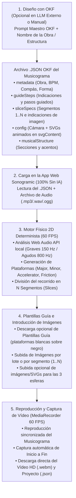

# Arquitectura y Manual Operativo OKF: Sonogramic (`v2.0.0`)

> **Autor**: Norberto Martín Afonso  
> **Repositorio**: `https://github.com/nmarafo/Sonogramic`  
> **Licencia**: GNU Affero General Public License v3.0 (Sección 7b) y Creative Commons CC BY-SA 4.0  
> **Versión OKF**: `1.3.0` (`urn:okf:software:sonogramic:2026:v2.0.0`)

---

## 1. Propósito del Estándar OKF en Sonogramic (Arquitectura 100 % Sin IA en la App)

**Sonogramic** separa de forma radical la **fase de diseño documental (OKF)** de la **fase de reproducción y captura de vídeo en la aplicación web**:

1. **El Estándar OKF (`okf.json`, `okf/`, `schema/`)**: Permite que cualquier persona usuaria o docente utilice su modelo de lenguaje preferido (Google NotebookLM, Gemini, Claude, ChatGPT, Ollama) de forma externa para generar un **archivo `.json` estandarizado** que contiene:
   - Las **indicaciones y pasos guiados (`guideSteps`)** para elaborar el musicograma.
   - La **planificación de los segmentos visuales (`sliceSpecs`)** con sus tiempos, notas didácticas y descripciones visuales (*prompts* listos para copiar si desean crear las ilustraciones externamente).
   - La **configuración visual y vectorial (`config`)**, incluyendo el código XML `<svg>...</svg>` animado de las esferas (*Principal*, *Melodía* y *Bajo*) embebido directamente dentro del JSON.
   - La **estructura musical y rítmica (`musicalStructure`)** con las secciones formales (`Intro`, `A`, `B`, `A'`, `Coda`), contornos melódicos e hitos rítmicos.
2. **La Aplicación Web Sonogramic (0 % IA · 100 % Cliente en Navegador)**:
   - **No utiliza Inteligencia Artificial ni requiere claves API ni servidores externos**.
   - Recibe únicamente el **archivo `.json` OKF**, las **imágenes que ustedes introduzcan** para cada segmento (y/o para las esferas) y el **archivo de audio** (o sintetiza la guía rítmica directamente desde el JSON si aún no se ha subido el audio).
   - Muestra en pantalla las indicaciones paso a paso del JSON, permite descargar las **plantillas guía de plataformas** de cada segmento, reproduce el musicograma fluido a **60 FPS** y **devuelve un archivo de vídeo HD (`.webm`)** tras capturar la reproducción completa del musicograma.

---

## 2. Diagrama del Flujo de Trabajo Desacoplado (OKF → JSON + Imágenes → App → Vídeo)

---

## 3. Anatomía del Archivo `.JSON` OKF del Musicograma

El esquema formal [`schema/schema_sonogramic_musicograma.json`](../schema/schema_sonogramic_musicograma.json) define cinco bloques principales en todo archivo `.json` de Sonogramic:

### 3.1. `metadata` (Ficha Musicológica y Pedagógica)
Contiene la información descriptiva de la obra musical:
- `title`: Título de la obra o canción.
- `composer`: Compositor, autor o agrupación.
- `musicalPeriodOrGenre`: Estilo o periodo histórico (ej. *Barroco*, *Romanticismo*, *Folclore Canario*).
- `educationalStage`: Nivel educativo recomendado (ej. *Primaria*, *ESO*, *Bachillerato*).
- `durationSeconds`: Duración total en segundos.
- `bpm`: Tempo en pulsos por minuto.
- `timeSignature`: Compás (ej. `"4/4"`, `"3/4"`, `"6/8"`).
- `musicalForm`: Estructura formal (ej. `"Rondó A-B-A-C-A"`).
- `pedagogicalObjectives`: Lista de objetivos de escucha activa.
- `emotions`: Etiquetas de carácter musical.
- `environmentConcept`: Descripción general del paisaje continuo por el que avanza el musicograma.

### 3.2. `guideSteps` (Indicaciones y Pasos para Generar el Musicograma)
Es una matriz ordenada de pasos que la aplicación muestra en el **Panel de Guía Paso a Paso OKF**. Cada paso incluye:
- `step`: Número de orden (`1..N`).
- `title`: Nombre corto del paso.
- `phase`: Fase operativa (`"preparacion"`, `"plantillas"`, `"imagenes"`, `"esferas"`, `"sincronizacion"`, `"grabacion"`).
- `instruction`: Explicación clara de lo que deben hacer ustedes en ese paso.
- `didacticTip`: Sugerencia metodológica o técnica.
- `targetAction`: Botón de acción rápida que la aplicación habilita directamente en la tarjeta del paso:
  - `"upload_audio"`: Abre el selector para cargar el archivo de audio (`.mp3`, `.wav`, `.ogg`).
  - `"download_layouts"`: Descarga las plantillas guía de plataformas (rectángulos blancos sobre fondo negro) de todos los segmentos.
  - `"upload_batch_images"`: Abre el selector múltiple para introducir de golpe las imágenes de todos los segmentos (`1..N`).
  - `"preview_playback"`: Inicia la reproducción de prueba del musicograma.
  - `"record_full_video"`: Rebobina al segundo `0:00`, captura el vídeo completo del musicograma de principio a fin y habilita su descarga.
  - `"export_project_json"`: Guarda el proyecto completo (`.json`) con todas las imágenes embebidas.

### 3.3. `sliceSpecs` (Especificación de los Segmentos del Mosaico `1..N`)
El recorrido horizontal completo del musicograma se divide en `mosaicSlices` segmentos consecutivos (`Segmento 1` a `Segmento N`). Cada elemento de `sliceSpecs` define:
- `index`: Índice del segmento (`0` a `N - 1`).
- `title`: Título descriptivo del tramo musical.
- `startTime` y `endTime`: Rango temporal en segundos.
- `musicalSection`: Sección formal (ej. `"Tema A"`, `"Puente"`, `"Coda"`).
- `dynamicsAndTempo`: Indicaciones de intensidad y agógica (ej. `"f — Allegro"`).
- `didacticNote`: Qué elementos sonoros o instrumentales se trabajan en este segmento.
- `imagePrompt`: Descripción visual detallada para que el agente generador (o la persona usuaria) cree la ilustración de fondo correspondiente a ese segmento, indicando qué atmósfera, colores y superficies deben aparecer sobre las plataformas.
- `recommendedPalette`: Colores hexadecimales sugeridos.
- `generatedByAgent`: Booleano (`true` / `false`) que indica si la imagen de fondo del segmento fue generada automáticamente por el agente mediante el estándar OKF.
- `imageUrl`: URL, ruta relativa o Data URI (`data:image/...;base64,...`) de la imagen de fondo generada por la herramienta de imagen del agente.
- `backgroundSvg`: Código XML `<svg viewBox="0 0 1024 1024" width="1024" height="1024" xmlns="http://www.w3.org/2000/svg">...</svg>` del escenario panorámico ilustrado multicapa generado por el agente e incrustado directamente en el JSON.

#### 3.3.1. Protocolo OKF de Generación Automática de Imágenes de Fondo por el Agente
Cuando el agente que procesa este OKF dispone de capacidad de generación gráfica (herramienta de generación de imágenes rasterizadas como *Imagen 3*, *DALL-E*, subagente `image-generator`, o capacidad de síntesis vectorial `<svg>`), **el estándar OKF le ordena generar automáticamente las imágenes necesarias para actuar de background en todos los segmentos (`sliceSpecs`)**:
1. **Agente con Herramienta de Imagen Rasterizada**: Genera las $N$ ilustraciones panorámicas siguiendo el `imagePrompt` y la paleta `recommendedPalette` de cada segmento, y las vincula en `sliceSpecs[i].imageUrl` (o las entrega numeradas como `01_segmento_1.png` ... `0N_segmento_N.png` para subida en lote).
2. **Incrustación Autocontenida en el JSON (`backgroundSvg`)**: El agente genera e incrusta en cada `sliceSpecs[i].backgroundSvg` un escenario panorámico `<svg viewBox="0 0 1024 1024" width="1024" height="1024" xmlns="http://www.w3.org/2000/svg">...</svg>` cuyo horizonte en el borde derecho ($x = 1024$) coincide con el borde izquierdo ($x = 0$) del segmento siguiente. Al importar el `.json` en **Sonogramic**, la aplicación carga y renderiza automáticamente todos los backgrounds sin requerir IA en la web app.

### 3.4. `config` (Cámara, Plataformas y Esferas con `svgContent` Embebido)
Controla el aspecto visual del lienzo sin necesidad de IA:
- `zoom` (`0.25` a `1.5`), `platformOpacity` (`0.0` a `1.0`), `bgOffsetY` (`-1000` a `1000`), `cameraSmoothness` (`0.0` a `0.98`) y `mosaicSlices` (`1` a `32`).
- `ballConfig` (Esfera principal) y `extraTracksConfig` (`melody` para agudos y `bass` para graves):
  - `shape`: `"circle"` | `"square"` | `"hexagon"` | `"star"` | `"music-note"` | `"custom-svg"`.
  - `color`: Color hexadecimal o `"dynamic"`.
  - `effect`: `"glow"` | `"outline"` | `"none"`.
  - `rotate`: `true` | `false`.
  - `opacity`: `0.0` a `1.0`.
  - `svgContent`: Código XML `<svg viewBox="0 0 100 100">...</svg>` (incluyendo animaciones nativas `<animate>` o `<animateTransform>`) que el JSON proporciona directamente para que la aplicación dibuje personajes, instrumentos o símbolos musicales animados sin llamar a ningún servicio externo.

### 3.5. `musicalStructure` (Coreografía Rítmica y Secciones)
Permite que el archivo `.json` funcione **tanto con un archivo de audio externo como de forma autónoma**:
- Cuando se sube un archivo de audio (`.mp3`, `.wav`, `.ogg`), el motor DSP local de **Sonogramic** filtra en el navegador la banda grave (`< 150 Hz`) y la banda melódica/aguda (`> 800 Hz`) mediante `OfflineAudioContext`, detecta los picos rítmicos reales y aplica los estilos de plataforma y energía definidos en `musicalStructure.sections`.
- Si se carga primero el archivo `.json` (antes de subir el audio), el motor construye instantáneamente las plataformas y la trayectoria a 60 FPS a partir de `metadata.bpm`, `metadata.durationSeconds` y `musicalStructure.sections` (o `customBeats`), permitiendo previsualizar el recorrido, descargar las plantillas guía de plataformas e introducir las imágenes de inmediato.

---

## 4. Geometría del Motor Físico y Plantillas Guía de Plataformas

Para que las imágenes introducidas encajen con precisión con el movimiento de las esferas:
1. **Velocidad Horizontal Constante**: La esfera principal avanza a `SPEED = 800 px/s` en el eje $X$. Por tanto, un segundo de música equivale exactamente a `800 píxeles` horizontales en el mundo virtual.
2. **Gravedad Parabólica y Rampas**:
   - Cuando la melodía desciende (`nextY > prevY`), el motor genera una **rampa continua (`mode: "ramp"`)** por la que la esfera rueda.
   - Cuando la melodía asciende o salta (`nextY <= prevY`), el motor calcula una **trayectoria parabólica exacta (`mode: "jump"`, $g = 2500\text{ px/s}^2$)** para que la esfera aterrice en el centro de la siguiente plataforma justo en el instante del pulso musical.
3. **Plantillas Guía de Plataformas (`1024 × 1024 px`)**:
   - Desde cada segmento del musicograma, ustedes pueden pulsar **«📐 Descargar Plantilla Guía»**.
   - La aplicación exporta una imagen con fondo negro (`#000000`) y las plataformas dibujadas como rectángulos blancos (`#ffffff`), incluyendo en el borde izquierdo una franja de referencia si el segmento anterior ya tiene una imagen cargada.
   - Al usar esa plantilla como guía para dibujar o componer la imagen de ese segmento y volver a subirla en ese mismo segmento, la esfera rodará y rebotará exactamente sobre las superficies de su ilustración.
   - Una vez colocadas las imágenes, pueden reducir el control **«Opacidad de Plataformas»** a `0.0`–`0.2` para que solo se vean sus ilustraciones de fondo mientras las esferas rebotan sobre ellas.
