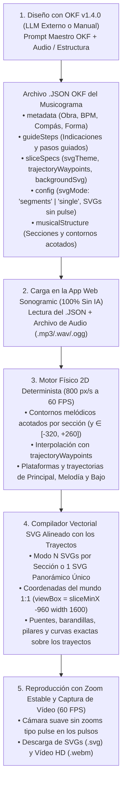

# Arquitectura y Manual Operativo OKF: Sonogramic (`v2.1.0`)

> **Autor**: Norberto Martín Afonso  
> **Repositorio**: `https://github.com/nmarafo/Sonogramic`  
> **Licencia**: GNU Affero General Public License v3.0 (Sección 7b) y Creative Commons CC BY-SA 4.0  
> **Versión OKF**: `1.4.0` (`urn:okf:software:sonogramic:2026:v2.1.0`)

---

## 1. Propósito del Estándar OKF v1.4.0 en Sonogramic (100 % Vectorial SVG Alineado con los Trayectos y Sin Zooms Tipo Pulse)

**Sonogramic** separa la **fase de diseño documental (OKF)** de la **fase de compilación vectorial determinista, reproducción y captura de vídeo en la aplicación web**:

1. **Sustitución Total de Imágenes Mapa de Bits por Uno o Varios SVGs Detallados**:
   - El estándar **OKF v1.4.0** elimina por completo la generación y el uso de imágenes mapa de bits (`.png`, `.jpg`, `.webp` o generadores de difusión como *Imagen 3* / *DALL-E*), ya que las ilustraciones rasterizadas no podían garantizar coincidencia geométrica exacta con las rampas, plataformas y parábolas del motor físico.
   - En su lugar, el OKF define **uno o varios SVGs vectoriales multicapa ultradetallados** (`backgroundSvg` por segmento cuando `svgMode: "segments"` o un único `masterSceneSvg` cuando `svgMode: "single"`), acompañados de su **tema arquitectónico (`svgTheme`)** y de **puntos de control de altura (`trajectoryWaypoints`)**.
   - Al cargarse en **Sonogramic**, el compilador vectorial determinista [`src/utils/svgTrajectoryCompiler.ts`](../src/utils/svgTrajectoryCompiler.ts) construye el dibujo SVG directamente en el **sistema de coordenadas exactas del mundo (`viewBox="${sliceMinX} -960 ${sliceWorldWidth} 1600"`)**, de modo que los puentes, balaustradas, rampas, pilares románicos, terreno esculpido, arcos parabólicos de salto y pentagramas aéreos coinciden con **error `0.0 px`** con los trayectos por donde ruedan y rebotan las tres esferas.

2. **Eliminación Radical de los Zooms Tipo Pulse en los Pulsos**:
   - Tanto el motor físico/cámara de la aplicación ([`src/components/AudioVisualizer.tsx`](../src/components/AudioVisualizer.tsx)) como la especificación de cursores SVG del JSON OKF **prohíben y eliminan cualquier zoom rítmico tipo *pulse*** en los pulsos musicales:
     - La cámara mantiene **el 100 % del tiempo el zoom fijo elegido por ustedes** (`userZoomRef.current`), sin saltos bruscos de escala (`1.25`, `1.18`, `1.08`) ni caídas a `0.72` en los impactos.
     - Se han eliminado los destellos blancos de pantalla (`hitFlash`) y los saltos de resplandor (`shadowBlur`) en los golpes fuertes.
     - El sanitizador `stripSvgPulseZoomAnimations` elimina automáticamente cualquier etiqueta `<animate attributeName="r">` o `<animateTransform type="scale">` en los cursores SVG para evitar que las esferas «bombeen» con los pulsos.

---

## 2. Diagrama del Flujo de Trabajo Desacoplado (OKF → JSON Vectorial → Compilador SVG 1:1 → Vídeo)

---

## 3. Anatomía del Archivo `.JSON` OKF v1.4.0

El esquema formal [`schema/schema_sonogramic_musicograma.json`](../schema/schema_sonogramic_musicograma.json) define cinco bloques principales:

### 3.1. `metadata` (Ficha Musicológica y Pedagógica)
- `title`, `composer`, `musicalPeriodOrGenre`, `educationalStage`, `durationSeconds`, `bpm`, `timeSignature`, `musicalForm`, `pedagogicalObjectives`, `emotions` y `environmentConcept`.

### 3.2. `guideSteps` (Indicaciones y Pasos Guiados)
Matriz ordenada de pasos interactivos en el panel lateral con botones de acción directa (`"upload_audio"`, `"download_layouts"`, `"upload_batch_images"`, `"preview_playback"`, `"record_full_video"`, `"export_project_json"`).

### 3.3. `sliceSpecs` (Segmentos Vectoriales Alineados con el Trayecto `1..N`)
Cada elemento de `sliceSpecs` define un tramo formal de la obra:
- `index`, `title`, `startTime`, `endTime`, `musicalSection`, `dynamicsAndTempo`, `didacticNote`.
- `svgTheme`: Tema arquitectónico y paisajístico para el compilador vectorial:
  - `"baroque"`: Jardines barrocos, templetes clásicos, cipreses, fuentes y balaustradas doradas.
  - `"cavern"`: Gruta subterránea nórdica, estalactitas, cristales minerales, antorchas y puentes de roca tallada.
  - `"canarias"`: Paisaje volcánico de Canarias, Roque Nublo/Teide, balconadas de madera de tea, cardones, dragos y pintaderas.
  - `"carnival"`: Escenario del Parque Santa Catalina, olas de Las Canteras, arcos festivos de neón, palmeras y confeti.
  - `"symphonic"`: Anfiteatro sinfónico, arcos acústicos y pabellones musicales.
- `trajectoryWaypoints`: Matriz de puntos de paso `[{ "time": segundos, "y": coordenadaY }]` (`y` entre `-320` y `+260`, donde valores negativos son más agudos/altos en pantalla y `0` es el nivel base en los bordes de sección) que moldea la altura exacta de las plataformas para que coincidan con el dibujo pensado para ese tramo.
- `backgroundSvg`: Código XML `<svg viewBox="0 0 1600 1000" xmlns="http://www.w3.org/2000/svg">...</svg>` con el cielo, atmósfera y paisaje lejano del segmento. Al cargarse en **Sonogramic**, el compilador integra este paisaje de fondo con todas las capas geométricas exactas del trayecto (terreno esculpido, pilares románicos, tableros de puente con barandillas y curvas de las 3 esferas).

### 3.4. `config` (Cámara Estable, Modo de SVG y Cursores sin Pulse Zoom)
- `zoom` (`0.25` a `1.5`): Factor de zoom **100 % fijo y estable** durante toda la reproducción (sin efectos *pulse* en los beats).
- `platformOpacity` (`0.0` a `1.0`): Por defecto `0.32`, ya que el propio dibujo SVG ya contiene los puentes, tablones, barandillas y pilares en la posición exacta de cada plataforma.
- `svgMode`:
  - `"segments"`: Compila y renderiza **varios SVGs detallados** (`mosaicSlices = N`, uno por cada sección musical de `sliceSpecs`).
  - `"single"`: Compila y renderiza **un único SVG panorámico maestro continuo** (`mosaicSlices = 1`) que abarca de principio a fin toda la obra.
- `masterSceneSvg`: SVG panorámico continuo opcional para el modo `"single"`.
- `ballConfig` y `extraTracksConfig` (`melody` y `bass`): Iconos vectoriales `svgContent` **libres de animaciones de escala o radio** (`<animate attributeName="r">` o `<animateTransform type="scale">`).

### 3.5. `musicalStructure` (Coreografía Rítmica Acotada por Sección)
- Cada sección define `startTime`, `endTime`, `label`, `focus`, `energy`, `subdivision`, `melodicContour` y `platformStyle`.
- El motor físico evalúa los contornos melódicos de forma **relativa a cada sección (`uSec ∈ [0, 1]`) y a cada segmento (`uSlice ∈ [0, 1]`)**, aplicando una envolvente suave $\sin^{\,0.7}(\pi \cdot u_{\text{slice}})$ que hace converger la altura $Y$ hacia `0` en las fronteras entre segmentos. De este modo, el recorrido se mantiene siempre dentro de la banda visual óptima ($y \in [-320, +260]$) y los bordes izquierdo y derecho de los SVGs contiguos encajan sin saltos.

---

## 4. Geometría Exacta 1:1 entre los SVGs y los Trayectos (`svgTrajectoryCompiler.ts`)

1. **Escala Espacial Determinista**:
   - La esfera principal avanza a `SPEED = 800 px/s` en el eje $X$.
   - El segmento $i$ abarca en el mundo el intervalo horizontal $[x_{\min}, x_{\max}]$ y el intervalo vertical $[-960, +640]$ (altura de mundo `1600 px`).
2. **Sistema de Coordenadas Compartido (`viewBox` de Mundo)**:
   - El compilador [`compileDetailedSliceSvg`](../src/utils/svgTrajectoryCompiler.ts) genera cada SVG con `viewBox="${sliceMinX} -960 ${sliceWorldWidth} 1600"` y `preserveAspectRatio="none"`, renderizándolo en el lienzo exactamente en `(sliceMinX, -960 + bgOffsetY, sliceWorldWidth, 1600)`.
   - Así, **1 unidad del SVG equivale exactamente a 1 píxel del mundo físico**:
     - Cada plataforma `{ x, y, width, height, angle, type }` se dibuja en el SVG mediante `<g transform="translate(x, y) rotate(angleDeg)">` con su tablero arquitectónico, su barandilla superior en `y = -height/2` (`-10 px`, línea exacta de contacto de la esfera de radio `20 px`) y sus pilares de piedra y arcos románicos descendiendo hasta el suelo (`y = 640`).
     - Las trayectorias completas `positions`, `melodyPositions` y `bassPositions` se trazan en el SVG como caminos de guía dorados, pentagramas aéreos de 5 líneas con notas musicales en los ápices y cimientos rítmicos de bajo, coincidiendo al 100 % con el movimiento de las esferas a 60 FPS.
